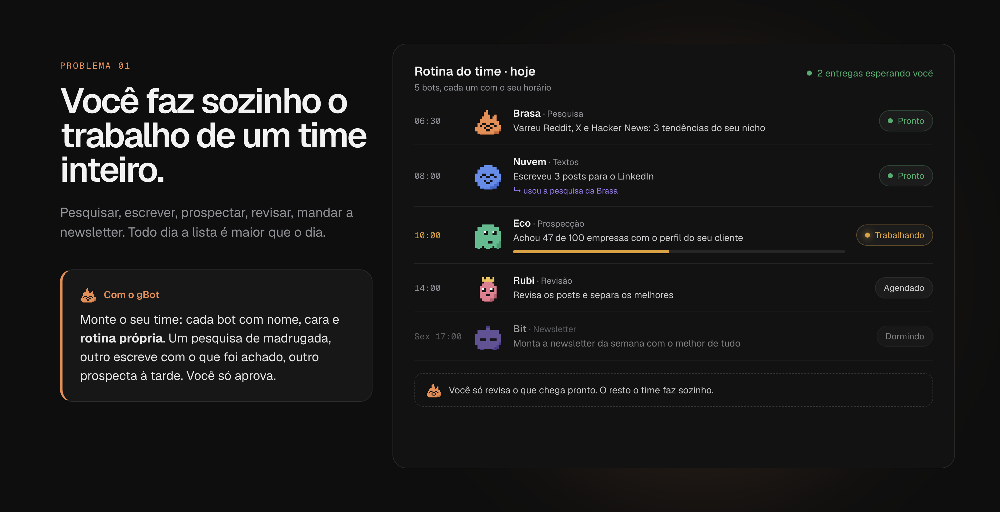
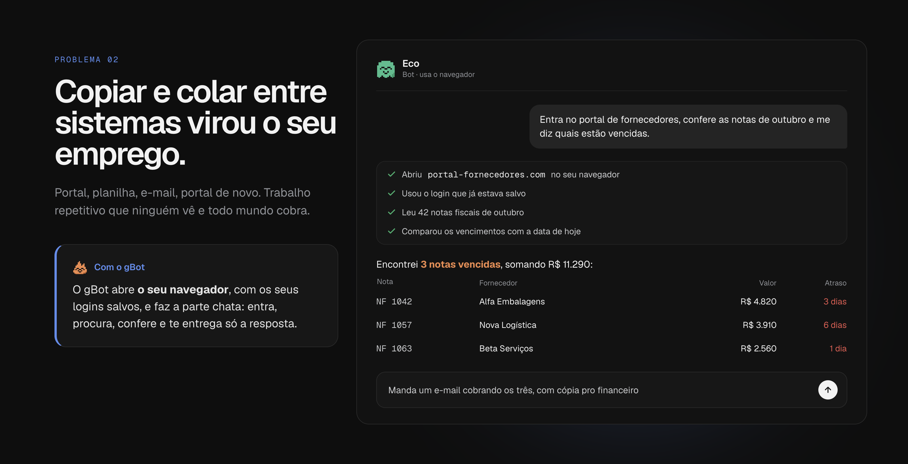
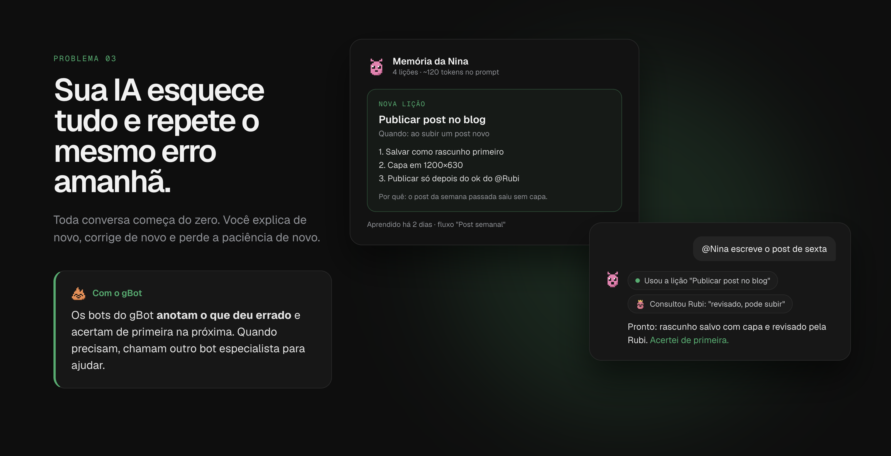
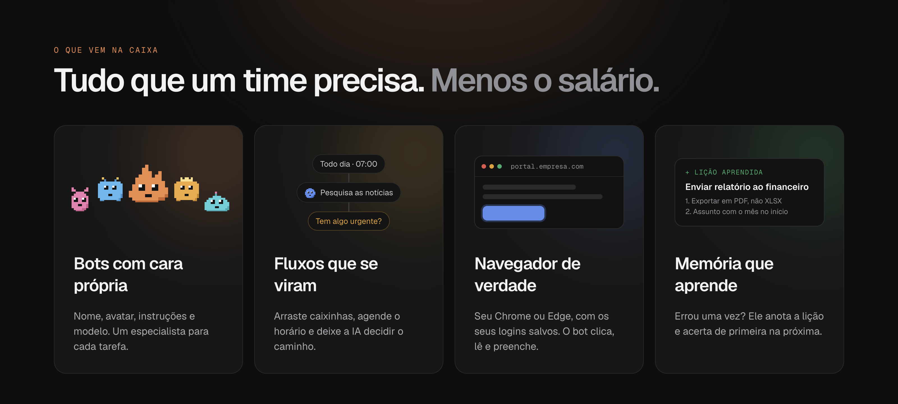

<p align="center">
  
</p>

<h1 align="center">gBot</h1>

<p align="center">
  <b>Monte um time de IA que trabalha enquanto você dorme.</b><br>
  Bots com personalidade, fluxos que rodam sozinhos, um navegador de verdade e memória que aprende.<br>
  Tudo no seu computador, usando a assinatura do Claude que você já paga.
</p>

<p align="center">
  <a href="#baixar">Baixar</a> ·
  <a href="#por-que-o-gbot">Por que o gBot</a> ·
  <a href="#o-que-vem-na-caixa">O que vem na caixa</a> ·
  <a href="#licença">Licença</a> ·
  <a href="#para-desenvolvedores">Para desenvolvedores</a>
</p>


Você já paga por uma IA incrível. Só que ela fica parada numa aba esperando você digitar. O **gBot** transforma a
sua assinatura do Claude num **time**: cada bot com nome, cara e especialidade; tarefas que rodam sozinhas no
horário; um navegador que eles usam por você; e uma memória que faz cada um errar menos a cada dia.

Sem chave de API, sem cobrança por token: o gBot usa o **Claude Code oficial** com o **seu login**, dentro dos
limites do seu plano.

## Por que o gBot

### 1. Chega de fazer sozinho o trabalho de um time inteiro



Pesquisar, escrever, prospectar, revisar, mandar a newsletter… a lista nunca acaba. No gBot você monta o seu
**time**: cada bot com nome, cara e **rotina própria** em fluxos agendados. Um varre as redes de madrugada, outro
escreve os posts com o que foi encontrado, outro prospecta à tarde, e uma **decisão** no meio do caminho escolhe o
que segue. Você acorda com as entregas prontas e só aprova.

### 2. Chega de copiar e colar entre sistemas



O gBot abre **o seu Chrome ou Edge**, com os logins que você já fez, e faz a parte chata: entra no portal, procura,
confere, cruza os dados e te devolve só a resposta. Logins, códigos e CAPTCHAs continuam com você.

### 3. Chega de IA que esquece tudo e repete o mesmo erro



Cada bot e cada fluxo tem uma **memória de lições**: quando algo dá errado e ele descobre o jeito certo, anota um
procedimento curto e acerta de primeira na próxima vez. Você vê, edita ou desliga cada lição. E quando um bot
precisa de ajuda, ele **chama outro bot** especialista, ou você chama qualquer um com `@Nome`.

## O que vem na caixa



- **Bots com personalidade:** nome, avatar em pixel art (20 prontos + gerador), instruções e modelo próprios.
- **Conversas:** com ou sem bot, com seleção de modelo (Opus, Sonnet, Haiku…) por conversa.
- **Projetos:** agrupam bots e conversas, com pasta de trabalho e instruções opcionais.
- **Fluxos:** canvas com gatilho por horário ou intervalo e caixinhas de bot, prompt e **decisão**. Rodam até
  com a janela fechada, pelo ícone na barra de menu.
- **Navegador do gBot:** Edge, Chrome ou Brave instalados, com perfil próprio e logins que ficam salvos.
- **Memória que aprende:** lições curtas e baratas em tokens, por bot e por fluxo, com tela para ver e editar.
- **Painel do time:** na tela inicial, quem está trabalhando, quem está dormindo e o que vem a seguir.

## Baixar

Os instaladores ficam na página de **Releases** do repositório (e em **Actions → Build** para versões de teste):

- **macOS:** `gBot-<versão>-mac-arm64.dmg` (Apple Silicon) ou `-mac-x64.dmg` (Intel).
  Como o app ainda não é assinado, na primeira vez clique com o botão direito no gBot → **Abrir**.
- **Windows** (beta): `gBot-<versão>-windows-setup.exe`. Se o SmartScreen avisar, **Mais informações →
  Executar assim mesmo**.

Você também precisa do **Claude Code** instalado e de uma assinatura do Claude (Pro ou Max):

```bash
# macOS
curl -fsSL https://claude.ai/install.sh | bash
```

```powershell
# Windows (PowerShell)
irm https://claude.ai/install.ps1 | iex
```

Depois é só abrir o gBot e clicar em **Entrar com Claude Code**: o login é o oficial, feito no navegador, num
perfil separado do seu terminal.

## Licença

O gBot é **código aberto sob a licença MIT** ([LICENSE](LICENSE)), o mesmo modelo do VS Code:

- Qualquer pessoa pode usar, estudar, fazer **fork** e modificar o código.
- Melhorias voltam para o projeto principal por **pull request**: ao enviar uma contribuição, ela fica licenciada
  sob a mesma MIT e pode ser incorporada ao gBot (detalhes em [CONTRIBUTING.md](CONTRIBUTING.md)).
- O nome **gBot** e o mascote **Brasa** identificam o projeto oficial: forks publicados são bem-vindos, só que com
  outro nome e outro ícone.

---

## Para desenvolvedores

Chat desktop (Electron + React) que conversa com o Claude Code usando a sua assinatura, já preparado para outros
provedores.

### Comandos

```bash
npm run dev        # abre o app em modo desenvolvimento (hot reload)
npm run typecheck  # checa os tipos
npm run dist:mac   # instaladores do Mac em dist/ (arm64 e Intel)
npm run dist:win   # instalador do Windows em dist/ (rode no Windows)
npm run icon       # regenera build/icon.png e as imagens de brand/ a partir do avatar em pixel art
npm run marketing  # regenera as imagens do README (docs/marketing/)
```

### Estrutura

```
src/
├─ main/                 processo principal (Node)
│  ├─ index.ts           janela
│  ├─ store.ts           bots e conversas em JSON (~/Library/Application Support/gBot/data)
│  ├─ ipc.ts             ponte main ⇄ interface
│  └─ providers/         um provedor por arquivo/pasta + registry.ts
│     └─ claude-code/    sessões `claude -p` em stream-json (uma por conversa)
├─ preload/              expõe `window.gbot` para a interface
├─ shared/types.ts       tipos usados dos dois lados
└─ renderer/src/         interface React
   ├─ avatars/           sprites em pixel art, partes e gerador de avatares
   ├─ components/        PixelAvatar, Sidebar, Composer, ui
   ├─ views/             Início, Chat, Bot, Editor de bot, Login, Avatares, Provedores, Configurações
   └─ state/app.tsx      estado do app (tema, avatar, provedor, conversas)
```

### Como o Claude Code é usado

O gBot abre o executável oficial `claude` (sem modificações) em modo
`-p --input-format stream-json --output-format stream-json`. Cada conversa é uma sessão do Claude Code
(`--session-id` = id da conversa), que fica aberta enquanto é usada e é retomada com `--resume`.
O app nunca lê nem guarda credenciais.

**Perfil separado:** o Claude Code roda com `CLAUDE_CONFIG_DIR=~/Library/Application Support/gBot/claude-profile`
e sem as variáveis `ANTHROPIC_*`/`CLAUDE*` herdadas. Assim o gBot não usa o `~/.claude` do terminal (que pode
apontar para outra conta ou um gateway corporativo). O login é feito em Provedores → "Entrar com conta Claude",
que roda o `claude auth login` oficial (abre o navegador). Equivalente no terminal:

```bash
CLAUDE_CONFIG_DIR="$HOME/Library/Application Support/gBot/claude-profile" claude auth login
```

A pasta de trabalho é `~/Library/Application Support/gBot/workspace`.

Ações que pedem permissão são negadas por enquanto (modo `manual`); aprovar pelo app é a Etapa 3.

### Conversas normais e bots

Conversa normal não tem personagem: sem nome, avatar ou persona no prompt. Bots aparecem só em conversas
com um bot ou quando mencionados com `@`. Conversas e bots podem ser excluídos pelo "⋯" (menu lateral, cabeçalho
do chat e página do bot), sempre com confirmação.

### Memória (bots e fluxos aprendem)

Cada bot e cada fluxo tem uma memória de **lições** (`data/memory/<bot|flow>-<id>.json`): título, quando usar,
passos curtos e por quê.

- O próprio Claude registra com a ferramenta `save_lesson` (só existe em sessões de bot ou de fluxo; conversa normal
  não tem memória). Mesmo título atualiza a lição em vez de duplicar.
- **Reflexão automática:** se num turno alguma ferramenta falhou ou foi negada, o gBot manda (sem aparecer no chat)
  um pedido curto para registrar a lição, se houver. Os turnos da sessão ficam em fila, então a próxima mensagem espera.
- As lições ativas entram no prompt de sistema num bloco compacto (`título | quando | passos`, sem o "por quê"),
  no máximo 30. A tela mostra ~quantos tokens isso ocupa.
- Onde ver/editar: página do bot (card **Memória**) e aba **Memória** do fluxo. Dá para adicionar à mão, editar,
  desligar (não vai para o prompt) e excluir. Caixinhas de prompt usam a memória do fluxo; caixinhas de bot, a do bot.

### Fluxos (canvas de automações)

Um fluxo é um canvas (React Flow) com um **gatilho** e caixinhas ligadas por setas:

- **Gatilho:** em horários (dias da semana + um ou mais horários) ou "repetir a cada N minutos/horas". Só fluxos
  **ativos** disparam; "Rodar agora" funciona sempre.
- **Bot:** manda uma mensagem a um bot (usa o modelo e as instruções dele).
- **Prompt:** prompt solto, com IA (provedor) e modelo escolhidos na caixinha.
- **Decisão:** a IA escolhida lê o resultado anterior e escolhe uma das opções; cada opção tem a própria bolinha de
  saída e só o caminho escolhido roda (os outros ficam como "pulados"). O critério opcional ajuda na escolha.
- Soltar uma linha no vazio abre um menu para criar a próxima caixinha já ligada. O painel lateral abre ao clicar
  numa caixinha e fecha ao clicar no canvas.
- O resultado das caixinhas anteriores vai junto automaticamente; `{{anterior}}` escolhe onde ele entra.
- Pode ramificar: ramos rodam em paralelo e uma caixinha espera todas as que chegam nela. Ciclos são recusados.
- Histórico das últimas 50 execuções por fluxo, com o resultado de cada caixinha (`data/flow-runs/<fluxo>.json`).
- O agendador roda no processo principal a cada 20 s. Fechar a janela não encerra o app: ele fica no **ícone da
  barra de menu** (Abrir gBot / fluxos ativos / Sair). Horários em que o app estava fechado não são executados depois.

### Navegador do gBot

O gBot abre o Edge/Chrome/Brave **instalado** (escolha em Configurações; padrão: Edge) com um perfil fixo em
`~/Library/Application Support/gBot/browser-profiles/<navegador>` e se conecta via CDP (`playwright-core`).

- O perfil é um só por navegador, compartilhado por todas as conversas e bots: logins e cookies ficam salvos
  entre conversas, bots e reinícios (o perfil já nasce com "continuar de onde parou" para manter cookies de sessão).
- Abre com `--disable-blink-features=AutomationControlled`, então os sites não veem `navigator.webdriver`.
- Ferramentas no MCP do gBot: `browser_navigate`, `browser_read`, `browser_click`, `browser_type`,
  `browser_press`, `browser_screenshot`, `browser_tabs`, `browser_back`.
- Por padrão o navegador acessa os sites direto. Em Configurações dá para ligar **Pedir aprovação antes de usar
  sites**: aí cada site novo mostra no chat **Permitir nesta conversa**, **Sempre em <site>** (vai para a lista de
  sites sempre permitidos) ou **Negar**; sem resposta em 5 min, é negado.
- O Claude não digita senhas nem códigos: login, MFA e CAPTCHA são feitos pelo usuário na janela.

### Modelos

Cada provedor declara os modelos que oferece (`ProviderInfo.models`). No Claude Code são os aliases
`default`, `opus`, `sonnet`, `haiku` e `fable` (este exige créditos de uso extras na conta).

- **Bot:** tem um modelo próprio, usado nas conversas com ele e quando outros bots o consultam.
- **Conversa:** tem o próprio modelo (seletor no campo de mensagem); começa com o do bot, se houver.
- Trocar o modelo reabre a sessão com `--model` + `--resume`: a conversa continua de onde parou.
- Cada resposta guarda o modelo usado (`ChatMessage.model`).

### Projetos

Projetos são opcionais: bots e conversas podem ficar soltos ou dentro de um projeto.

- **Pasta de trabalho** (opcional, pode ser escolhida depois): vira o `cwd` do Claude Code nas conversas e bots do
  projeto. Sem pasta, vale a pasta padrão do gBot.
- **Instruções do projeto** (opcionais): entram no prompt de sistema, somadas às instruções de cada bot.
- **Bots visíveis**: dentro de um projeto, os bots dele + os bots soltos; bots de outros projetos ficam de fora.
- Excluir um projeto não apaga nada: os bots e conversas dele voltam a ficar soltos.
- Se a pasta, as instruções ou o projeto da conversa mudam, a sessão do Claude Code é reaberta com `--resume`.

### Bots conversando entre si

O processo principal sobe um servidor MCP em `127.0.0.1` (porta aleatória) com duas ferramentas,
`list_bots` e `ask_bot`. Toda sessão do Claude Code aberta pelo gBot recebe esse servidor via
`--mcp-config`, com um token próprio que identifica quem está chamando (conversa, bot, profundidade).

- `ask_bot` abre (ou reaproveita) a sessão daquele bot **dentro da conversa** (`<conversa>:<bot>`), então
  o bot lembra das consultas e @menções anteriores daquela conversa.
- Proteções: no máximo 3 consultas encadeadas, sem ciclos (A → B → A) e 10 min por consulta.
- `@Nome` no chat envia a mensagem direto ao bot; a resposta aparece com o avatar dele, e o assistente
  da conversa recebe essa troca como contexto na mensagem seguinte.

### Adicionar um provedor

1. Crie `src/main/providers/<nome>.ts` implementando `ChatProvider` (`checkStatus` + `send`).
2. Registre na lista em `src/main/providers/registry.ts`.

A interface lista o provedor automaticamente; `send` emite eventos `mood`, `delta`, `done` ou `error`.

### Builds (GitHub Actions)

`.github/workflows/build.yml` roda o typecheck e gera os instaladores do macOS (`.dmg` arm64 e Intel) e do Windows
(`setup.exe`) em todo push na `main` e em pull requests; ficam em **Actions → Build → Artifacts**. Uma tag `v*`
(`git tag v0.3.0 && git push --tags`) também cria a **Release** com os instaladores anexados.

Os instaladores ainda não são assinados (sem certificado da Apple nem da Microsoft), por isso o primeiro aberto
mostra o aviso do sistema.

### Etapas

1. ✅ Esqueleto, design MagmaFit, avatares, chat de teste, instalador
2. ✅ Conversa com o Claude Code (streaming, ferramentas, memória, interromper)
3. ✅ Bots (nome, avatar, instruções), 20 avatares + gerador, conversas salvas em disco
4. ✅ Bots consultando outros bots (`list_bots` / `ask_bot` via MCP local) e `@menções`
5. ✅ Projetos: agrupam bots e conversas, com pasta de trabalho e instruções opcionais
6. ✅ Fluxos: canvas com gatilho por horário/intervalo, caixinhas de bot, prompt e decisão, histórico e barra de menu
7. ✅ Navegador do gBot e memória de lições
8. Aprovar permissões no app
9. Ações no computador
