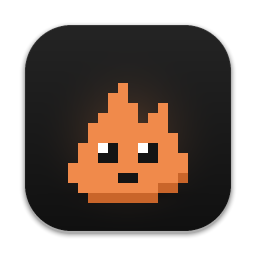
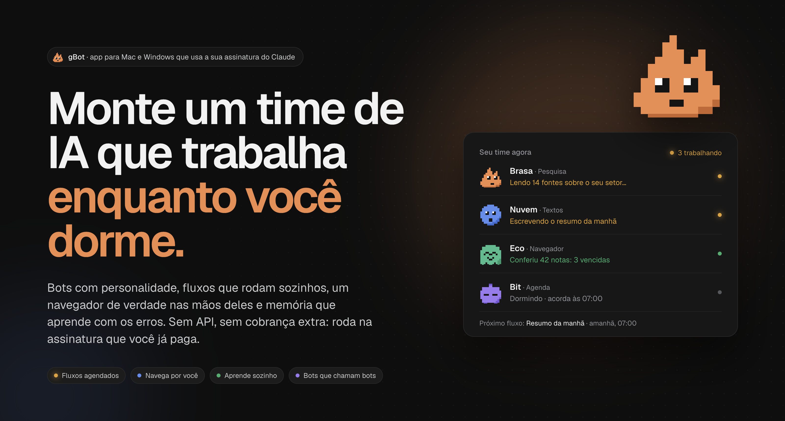
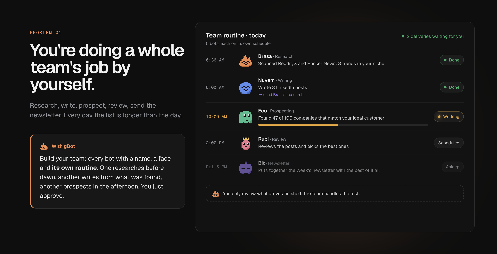
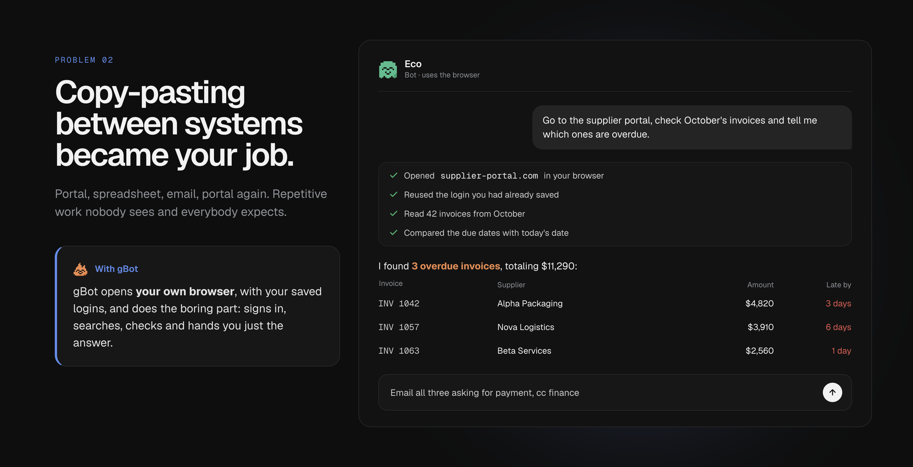
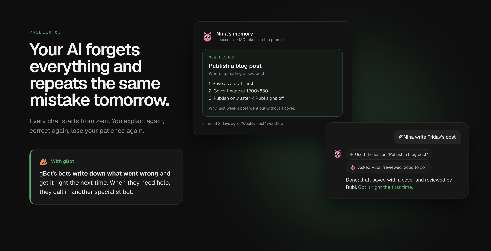
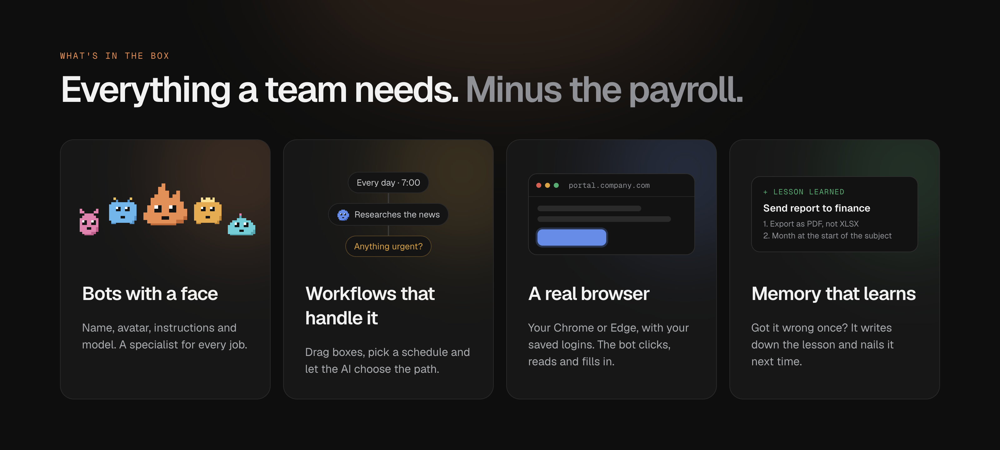

<p align="center">
  
</p>

<h1 align="center">gBot</h1>

<p align="center">
  <b>Build an AI team that works while you sleep.</b><br>
  Bots with personality, workflows that run on their own, a real browser and a memory that learns.<br>
  All on your own computer, running on the Claude subscription you already pay for.
</p>

<p align="center">
  <a href="https://github.com/dvGomez/gBot/actions/workflows/build.yml"></a>
  <a href="https://github.com/dvGomez/gBot/releases"></a>
  <a href="LICENSE"></a>
  
</p>

<p align="center">
  <a href="#download">Download</a> ·
  <a href="#why-gbot">Why gBot</a> ·
  <a href="#whats-in-the-box">What's in the box</a> ·
  <a href="#contributing">Contributing</a> ·
  <a href="#license">License</a> ·
  <a href="#for-developers">For developers</a>
</p>



You already pay for an amazing AI. But it just sits in a browser tab waiting for you to type. **gBot** turns your
Claude subscription into a **team**: every bot with a name, a face and a specialty; jobs that run on their own
schedule; a browser they drive for you; and a memory that makes each of them a little better every day.

No API keys, no per-token bill: gBot runs the **official Claude Code** with **your own login**, within your plan's
limits.

## Why gBot

### 1. Stop doing a whole team's job by yourself



Research, write, prospect, review, send the newsletter… the list never ends. In gBot you build your **team**: every
bot with a name, a face and **its own routine** in scheduled workflows. One scans the web before dawn, another
writes posts from what was found, another prospects in the afternoon, and a **decision** box in the middle picks
what happens next. You wake up to finished work and just approve it.

### 2. Stop copy-pasting between systems



gBot opens **your own Chrome or Edge**, with the logins you already have, and does the boring part: signs in to the
portal, searches, checks, cross-references and hands you just the answer. Passwords, 2FA codes and CAPTCHAs stay
with you.

### 3. Stop using an AI that forgets everything



Every bot and every workflow has a **memory of lessons**: when something goes wrong and it figures out the right
way, it writes down a short procedure and gets it right the first time next time. You can see, edit or turn off
every lesson. And when a bot needs help, it **calls another bot**, or you can call any of them with `@Name`.

## What's in the box



- **Bots with personality:** name, pixel-art avatar (20 built in + a generator), their own instructions and model.
- **Chats:** with or without a bot, with a model picker (Opus, Sonnet, Haiku…) per chat.
- **Projects:** group bots and chats, with an optional working folder and instructions.
- **Workflows:** a canvas with a time or interval trigger and bot, prompt and **decision** boxes. They keep running
  with the window closed, from the menu bar icon.
- **gBot's browser:** your installed Edge, Chrome or Brave, with its own profile and logins that stay saved.
- **A memory that learns:** short, token-cheap lessons per bot and per workflow, with a screen to view and edit them.
- **Reference files:** drop contracts, manuals, price lists or screenshots on a bot's page; it reads them only when a
  request needs them.
- **Team panel:** on the home screen, who is working, who is asleep and what's coming up next.

## Download

Installers are on the **[Releases](https://github.com/dvGomez/gBot/releases)** page (and under
**[Actions → Build](https://github.com/dvGomez/gBot/actions/workflows/build.yml)** for test builds):

- **macOS:** `gBot-<version>-mac-arm64.dmg` (Apple Silicon) or `-mac-x64.dmg` (Intel).
  The app isn't signed yet, so the first time, right-click gBot → **Open**.
- **Windows** (beta): `gBot-<version>-windows-setup.exe`. If SmartScreen warns you, click **More info → Run anyway**.

You also need **Claude Code** installed and a Claude subscription (Pro or Max):

```bash
# macOS
curl -fsSL https://claude.ai/install.sh | bash
```

```powershell
# Windows (PowerShell)
irm https://claude.ai/install.ps1 | iex
```

Then open gBot and click **Sign in with Claude Code**: it's the official login, done in your browser, in a profile
kept separate from your terminal.

## Contributing

Pull requests are very welcome, from typo fixes to whole new features. Read [CONTRIBUTING.md](CONTRIBUTING.md) to
get started, look for issues labeled
[`good first issue`](https://github.com/dvGomez/gBot/issues?q=is%3Aissue+is%3Aopen+label%3A%22good+first+issue%22),
and share ideas in [Discussions](https://github.com/dvGomez/gBot/discussions).

## License

gBot is **open source under the MIT license** ([LICENSE](LICENSE)), the same model as VS Code:

- Anyone can use, study, **fork** and modify the code.
- Improvements come back to the main project through **pull requests**: by sending a contribution you license it
  under the same MIT license, so it can be merged into gBot (details in [CONTRIBUTING.md](CONTRIBUTING.md)).
- The **gBot** name and the **Brasa** mascot identify the official project: published forks are welcome, just with
  a different name and icon.

---

## For developers

A desktop app (Electron + React) that talks to Claude Code using your subscription, ready for other providers.

### Commands

```bash
npm run dev        # run the app in development mode (hot reload)
npm run typecheck  # type-check everything
npm run dist:mac   # Mac installers in dist/ (arm64 and Intel)
npm run dist:win   # Windows installer in dist/ (run it on Windows)
npm run icon       # regenerate build/icon.png and brand/ from the pixel-art avatar
npm run marketing  # regenerate the README images (docs/marketing/)
```

### Layout

```
src/
├─ main/                 main process (Node)
│  ├─ index.ts           window, tray and scheduler
│  ├─ store.ts           bots and chats as JSON (<userData>/data)
│  ├─ ipc.ts             main ⇄ UI bridge
│  ├─ flows/             workflow store, runner and scheduler
│  ├─ browser/           gBot's browser (CDP) and its MCP tools
│  ├─ memory.ts          per-bot and per-workflow lessons
│  └─ providers/         one provider per file/folder + registry.ts
│     └─ claude-code/    `claude -p` sessions over stream-json (one per chat)
├─ preload/              exposes `window.gbot` to the UI
├─ shared/types.ts       types shared by both sides
└─ renderer/src/         React UI
   ├─ avatars/           pixel-art sprites, parts and the avatar generator
   ├─ components/        sidebar, composer, flow canvas nodes, team panel, memory panel…
   ├─ views/             Home, Chat, Bot, Projects, Flow editor, Login, Providers, Settings
   └─ state/app.tsx      app state
```

`<userData>` is `~/Library/Application Support/gBot` on macOS and `%APPDATA%\gBot` on Windows.

### How Claude Code is used

gBot runs the official, unmodified `claude` executable in
`-p --input-format stream-json --output-format stream-json` mode. Each chat is a Claude Code session
(`--session-id` = chat id) that stays open while in use and is picked back up with `--resume`. The app never reads
or stores credentials.

**Separate profile:** Claude Code runs with `CLAUDE_CONFIG_DIR=<userData>/claude-profile` and without any inherited
`ANTHROPIC_*`/`CLAUDE*` variables. That way gBot doesn't use your terminal's `~/.claude` (which might point to
another account or a corporate gateway). Sign-in happens under Providers → "Sign in with Claude", which runs the
official `claude auth login` (it opens the browser). Terminal equivalent on macOS:

```bash
CLAUDE_CONFIG_DIR="$HOME/Library/Application Support/gBot/claude-profile" claude auth login
```

The default working folder is `<userData>/workspace`. On Windows, gBot looks for the native installer's
`claude.exe` (`~/.local/bin`) or the first one on the `PATH`.

### Permissions

Claude Code runs with `--permission-mode acceptEdits` and `--permission-prompt-tool mcp__gbot__approve`:

- Creating and editing files inside the working folder (and the bot's reference folder) never asks.
- Everything else that needs permission (shell commands, files outside the folder…) reaches gBot's `approve` MCP tool
  and shows a card in the chat with the exact command: **Allow in this chat**, **Always allow** or **Deny**. Requests
  from workflows show up at the top of the app with the same buttons. No answer in 5 min means deny.
- "Always" remembers the program for simple commands (`Bash:textutil`) or the folder for files; a chained command
  (`&&`, `|`, `;`, redirects) is only remembered exactly as it was, so an approval can't smuggle in another program.
  The list lives in Settings → Commands and files, where it can be cleared.
- Settings also has **Allow commands without asking** (off by default) for people who prefer no prompts at all.

### Chat attachments and live steps

- **Attachments:** the paperclip button, drag and drop or ⌘V (pasted screenshots too) copy files into
  `data/attachments/<chat>/`. The chat's session, and any bot called in it, gets read access to that folder
  (`--add-dir` + a `Read` allow rule) and the message lists the files, so Claude reads text, PDFs and images as needed.
  Images get a small thumbnail (made with `nativeImage`) saved with the message. Deleting the chat deletes them.
- **Live steps:** replies keep the order in which things happened (`ChatMessage.steps`: text, tools, more text), so
  tool calls show up in the flow of the conversation instead of grouped at the top. While a reply is running, a status
  line says what's going on: "Pensando…", "Trabalhando: <tool>…", "Escrevendo…" or "Esperando sua aprovação…".

### Generated files

When a reply ends, gBot looks for files created or changed in the working folder during it (up to two subfolders
deep, at most 12, skipping `node_modules`, `dist`, `.git`…) and attaches them to the message as cards. That includes
files made by commands, like a PDF converted from HTML. Clicking a card opens the file in its default app (scripts
and executables are only revealed in the folder, never run); the folder button reveals it in Finder/Explorer.

### Plain chats and bots

A plain chat has no character: no name, avatar or persona in the prompt. Bots only show up in chats with a bot or
when mentioned with `@`. Chats and bots can be deleted from the "⋯" menu (sidebar, chat header and bot page), always
with a confirmation.

### Memory (bots and workflows learn)

Each bot and each workflow has a memory of **lessons** (`data/memory/<bot|flow>-<id>.json`): title, when to use it,
short steps and why.

- Claude records them itself with the `save_lesson` tool (only in bot or workflow sessions; plain chats have no
  memory). The same title updates the lesson instead of duplicating it.
- **Automatic reflection:** if a tool failed or was denied during a turn, gBot sends a short hidden prompt asking to
  record a lesson, if there is one. Turns are queued per session, so the next message waits.
- Active lessons go into the system prompt as a compact block (`title | when | steps`, without the "why"), at most
  30. The screen shows roughly how many tokens that takes.
- Where to view and edit them: the bot page (**Memory** card) and the workflow's **Memory** tab. You can add them by
  hand, edit, turn off (kept out of the prompt) and delete.

### Reference files

Each bot has a folder of reference files (`data/bot-files/<bot>/`), managed on the bot page: drag files in or use
**Add**, write an optional note per file, reveal or delete them.

- The bot's system prompt only lists the files (`name | size | note`, at most 50); the content is read with Claude
  Code's `Read` tool when a request needs it, so files cost no tokens until they're used.
- Every session that runs as the bot (its chats, workflow steps, consultations and @mentions) gets the folder through
  `--add-dir` plus a `Read(//<folder>/**)` allow rule.
- `Read` handles text (txt, md, csv, json…), PDFs and images. Word, Excel and PowerPoint files show a warning on the
  page: export them as PDF or CSV.
- Deleting a bot deletes its files.

### Workflows (automation canvas)

A workflow is a canvas (React Flow) with a **trigger** and boxes connected by arrows:

- **Trigger:** at set times (weekdays + one or more times) or "repeat every N minutes/hours". Only **active**
  workflows fire; "Run now" always works.
- **Bot:** sends a message to a bot (using its model and instructions).
- **Prompt:** a standalone prompt, with the AI (provider) and model picked in the box.
- **Decision:** the chosen AI reads the previous result and picks one of the options; each option has its own
  output dot and only the chosen path runs (the others are marked "skipped"). An optional criterion helps it choose.
- The result of earlier boxes is passed along automatically; `{{anterior}}` sets where it goes.
- **Run context:** every box (decisions included) also gets a short trail of the run so far: what each earlier box on
  its path was asked, a clipped version of what it returned and what each decision chose. A box at the end still knows
  details said only at the start (who it's for, which contact…). It only lives for that run and is capped (400 chars
  per instruction, 600 per result, the first 3 and last 9 steps in long flows).
- Branches run in parallel and a box waits for everything that leads into it. Cycles are rejected.
- Dropping a line on empty canvas opens a menu to create the next box already connected; ⌘C/⌘V (Ctrl on Windows)
  duplicates boxes. The side panel opens when you click a box and closes when you click the canvas.
- History of the last 50 runs per workflow, with each box's result (`data/flow-runs/<flow>.json`).
- The scheduler runs in the main process every 20 s. Closing the window doesn't quit the app: it stays in the
  **menu bar icon** (Open gBot / active workflows / Quit). Times when the app was closed are not run afterwards.

### gBot's browser

gBot opens your **installed** Edge/Chrome/Brave (pick it in Settings; default: Edge) with a fixed profile in
`<userData>/browser-profiles/<browser>` and connects over CDP (`playwright-core`).

- There's one profile per browser, shared by every chat and bot: logins and cookies persist across chats, bots and
  restarts (the profile starts with "continue where you left off" to keep session cookies).
- It launches with `--disable-blink-features=AutomationControlled`, so sites don't see `navigator.webdriver`.
- Tools on gBot's MCP server: `browser_navigate`, `browser_read`, `browser_click`, `browser_type`,
  `browser_press`, `browser_upload`, `browser_screenshot`, `browser_tabs`, `browser_back`.
- **Attaching files:** `browser_upload` clicks the element that would open the system's file picker (e.g. WhatsApp
  Web's "Document") and hands the files straight to the page, so the native window never opens. Files from gBot's
  folders (workspace, project folders, bot files) go without asking; anything else asks for approval first.
- By default the browser goes straight to sites. In Settings you can turn on **Ask before using sites**: each new
  site then shows **Allow in this chat**, **Always on <site>** or **Deny** in the chat; with no answer in 5 min, it's
  denied.
- Claude doesn't type passwords or codes: login, MFA and CAPTCHAs are done by you in the window.

### Models

Each provider declares the models it offers (`ProviderInfo.models`). For Claude Code these are the aliases
`default`, `opus`, `sonnet`, `haiku` and `fable` (the latter requires extra usage credits on the account).

- **Bot:** has its own model, used in chats with it and when other bots consult it.
- **Chat:** has its own model (picker in the message box); it starts with the bot's, if any.
- Switching models reopens the session with `--model` + `--resume`: the chat continues where it left off.
- Each reply records the model used (`ChatMessage.model`).

### Projects

Projects are optional: bots and chats can live on their own or inside a project.

- **Working folder** (optional, can be picked later): becomes Claude Code's `cwd` for the project's chats and bots.
  Without one, gBot's default folder is used.
- **Project instructions** (optional): go into the system prompt, on top of each bot's instructions.
- **Visible bots**: inside a project, its own bots plus the standalone ones; other projects' bots are hidden.
- Deleting a project deletes nothing: its bots and chats become standalone again.
- If the folder, the instructions or the chat's project change, the Claude Code session is reopened with `--resume`.

### Bots talking to each other

The main process starts an MCP server on `127.0.0.1` (random port) with `list_bots` and `ask_bot`. Every Claude Code
session gBot opens gets that server through `--mcp-config`, with its own token identifying the caller (chat, bot,
depth).

- `ask_bot` opens (or reuses) that bot's session **inside the chat** (`<chat>:<bot>`), so the bot remembers earlier
  consultations and @mentions in that chat.
- Safeguards: at most 3 chained consultations, no cycles (A → B → A) and 10 min per consultation.
- `@Name` in the chat sends the message straight to the bot; the reply shows its avatar, and the chat's assistant
  gets that exchange as context in the next message.
- **One task at a time:** each bot has a work queue (`src/main/botQueue.ts`). Workflow steps, chat messages and
  consultations from other bots wait their turn, so two workflows never drive the same bot (and its browser) at once.
  The bot page lists what it's doing and what's waiting, with buttons to cancel or interrupt. A workflow step's
  15-minute limit only starts when the bot actually picks it up.

### Adding a provider

1. Create `src/main/providers/<name>.ts` implementing `ChatProvider` (`checkStatus` + `send`).
2. Register it in `src/main/providers/registry.ts`.

The UI lists the provider automatically; `send` emits `mood`, `delta`, `done` or `error` events.

### Builds (GitHub Actions)

`.github/workflows/build.yml` type-checks and builds the macOS (`.dmg`, arm64 and Intel) and Windows (`setup.exe`)
installers on every push to `main` and on pull requests; they show up under **Actions → Build → Artifacts**. A `v*`
tag (`git tag v0.3.0 && git push --tags`) also creates a **Release** with the installers attached.

The installers aren't signed yet (no Apple or Microsoft certificate), so the first launch shows the system warning.

### Roadmap

1. ✅ Skeleton, design, avatars, test chat, installer
2. ✅ Chatting with Claude Code (streaming, tools, memory, interrupt)
3. ✅ Bots (name, avatar, instructions), 20 avatars + generator, chats saved to disk
4. ✅ Bots consulting other bots (`list_bots` / `ask_bot` over local MCP) and `@mentions`
5. ✅ Projects: group bots and chats, with an optional working folder and instructions
6. ✅ Workflows: canvas with time/interval triggers, bot, prompt and decision boxes, history and menu bar icon
7. ✅ gBot's browser and lesson memory
8. ✅ Approving permissions in the app (commands, files outside the working folder)
9. Actions on the computer
